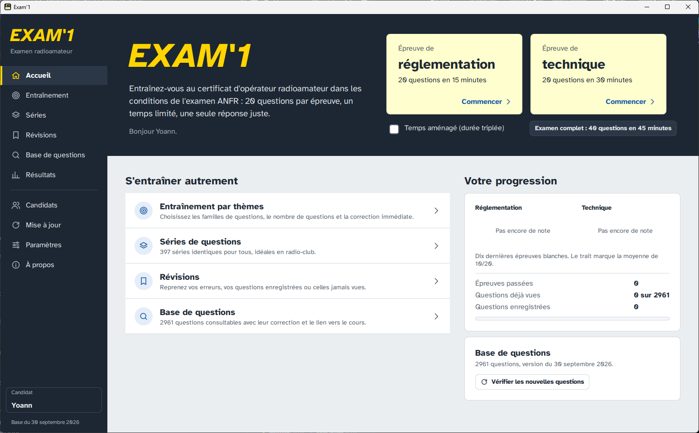

# Exam'1 (édition Qt 6 / QML)

Examens blancs du certificat d'opérateur du service amateur (radioamateur, ANFR), développés en C++17, Qt 6 et QML pour Windows, Linux, macOS et Android (téléphones et tablettes).

L'application utilise la base de questions Exam'1, tenue à jour par Jean-Luc F6GPX. La base est mise à jour chaque trimestre, et l'application peut installer elle-même les nouvelles versions.

L'écran d'examen reproduit l'interface que l'ANFR utilise désormais pour l'examen (Evalbox). Toutes les questions sont présentées dans une seule liste verticale. Les propositions sont des cases à cocher, les questions peuvent être épinglées, une grille numérotée montre les questions répondues et épinglées, et le candidat valide l'ensemble une seule fois avec **Finaliser l'examen**.



## Fonctionnalités

- **Examens blancs dans les conditions de l'ANFR**
  - Épreuve de réglementation : 20 questions en 15 minutes. Épreuve de technique : 20 questions en 30 minutes. Chaque épreuve tire 2 questions dans chacune de ses 10 familles.
  - Examen complet : 40 questions dans une seule liste, comme la démonstration de l'ANFR. Les questions 1 à 20 portent sur la réglementation et les questions 21 à 40 sur la technique ; chaque épreuve reçoit sa propre note.
  - Temps aménagé (×3) pour les candidats ayant un taux d'incapacité d'au moins 70 %.
  - Barème actuel : 1 point par bonne réponse, et 0 point pour une réponse fausse, une absence de réponse ou plusieurs cases cochées. Une épreuve est réussie à partir de 10/20. L'ancien barème d'avant 2021 (+3 / −1) reste disponible.
  - Sauvegarde automatique toutes les quelques secondes (« dernière sauvegarde »). Une session interrompue par un plantage ou une coupure de courant peut être reprise depuis l'accueil.
- **Entraînement par thèmes** : choix libre des familles, du nombre de questions (d'une à dix par thème coché : 6, 12, 18… avec 6 thèmes) et de la durée, avec correction immédiate en option (commentaire et lien vers le cours de F6KGL).
- **Numéro des questions** : à l'entraînement, le numéro de chaque question dans la base (par exemple n° 20003) s'affiche à côté de « Question 11 / 20 », pour la noter et la retrouver dans la consultation de la base. Un réglage permet de l'afficher toujours, seulement à l'entraînement (par défaut) ou jamais.
- **Séries** : les séries fixes C, P, R et T publiées avec la base. Tout le monde reçoit les mêmes questions, ce qui convient aux séances en radio-club.
- **Révisions** :
  - « Mes erreurs », en révision espacée : une question manquée revient le jour même, puis 1, 3 et 7 jours après chaque bonne réponse, et quitte la liste à la quatrième. Une nouvelle erreur la fait repartir du début.
  - « Mes thèmes faibles » : les thèmes réussis à moins de 75 % sur au moins 5 réponses, les questions manquées d'abord, puis celles jamais posées.
  - Questions enregistrées et questions jamais vues.
- **Consultation de la base** : questions présentées comme à l'examen (image seulement si elle est nécessaire), recherche par mot, valeur ou numéro, filtre par thème, par questions enregistrées ou par erreurs.
- **Résultats** : historique par candidat, évolution des notes, réussite dans chacun des 20 thèmes, correction complète de chaque épreuve passée. La correction se présente comme l'écran d'examen : propositions dans l'ordre affiché, cases cochées, bonne réponse, commentaire et lien vers le cours. Elle reste consultable à tout moment depuis « Résultats ».
- **Plusieurs candidats** sur le même ordinateur, chacun avec ses propres résultats et statistiques.
- **Sauvegarde et transfert** (Paramètres > Données) : les candidats, résultats, statistiques et questions enregistrées s'exportent dans un fichier `.exam1`. On l'importe sur un autre ordinateur ou téléphone, ou pour restaurer une sauvegarde. L'importation remplace les données de l'appareil, après confirmation ; une copie des données remplacées est gardée (`user-avant-import.sqlite`).
- **Nouvelles versions** : au démarrage (en option) ou à la demande, l'application demande à GitHub le numéro de la dernière version publiée. Si elle est plus récente, l'accueil l'annonce avec un lien vers le paquet du système. C'est la seule demande faite à GitHub ; rien n'est téléchargé ni installé automatiquement.
- **Accessibilité** : police à lisibilité renforcée (Atkinson Hyperlegible) en dehors de l'écran d'examen, taille du texte réglable, thème sombre (et écran d'examen sombre en option, l'examen de l'ANFR étant sur fond blanc) et réponses au clavier (A à D, P, Espace).
- **Mode portable** : un fichier vide `portable.txt` placé à côté de `exam1.exe` garde toutes les données dans un dossier `userdata` voisin, pratique sur une clé USB.
- **Téléphones et tablettes Android** : la même application, avec une interface tactile.
  - L'application s'ouvre en plein écran : les barres d'Android réapparaissent un instant en faisant glisser le doigt depuis le bord de l'écran.
  - Sur un téléphone, sur une tablette tenue en hauteur ou dans une fenêtre étroite, le menu de gauche laisse la place à une barre en haut de l'écran : son bouton ☰ ouvre le menu.
  - À l'écran d'examen, l'en-tête tient sur deux lignes et la grille des questions s'affiche avec le bouton **Grille**. Le bouton ou le geste Retour referme le menu ou la grille, revient à l'écran précédent, puis à l'accueil ; pendant une épreuve, il propose de l'abandonner.
  - Les cases, boutons et choix sont plus hauts, pour le doigt. L'épreuve en cours est enregistrée dès que l'application passe en arrière-plan.

## Base de questions et mises à jour

La base est celle de la version web d'Exam'1 (exam1.r-e-f.org) et de l'application Android. Le REF la publie sous forme de trois fichiers :

| Fichier | Contenu |
|---|---|
| `questions.json` | questions, propositions, réponse, thème, commentaire, lien vers le cours, date de `version` |
| `series.json` | séries fixes (C, P, R, T) |
| `questions.zip` | une image par question (`<numéro>.png`) ; l'archive contient aussi les images de questions retirées de la base, que l'installation ignore |

L'adresse par défaut est `https://exam1.r-e-f.org/assets/` ; elle peut être modifiée dans l'application.

- **Mise à jour en ligne** : l'application compare la `version` publiée à celle qui est installée, au démarrage (en option) ou à la demande. Elle télécharge ensuite les trois fichiers (environ 35 Mo) et construit une nouvelle base dans un dossier séparé. Elle ne bascule sur la nouvelle base qu'une fois la construction réussie : les données de l'utilisateur (candidats, notes, questions enregistrées) ne sont jamais touchées.
- **Import hors ligne** : choisir un dossier, ou une archive ZIP, contenant les trois fichiers. Sur Android, seule l'archive ZIP peut être choisie.
- **Base fournie avec l'installeur** : si `packaging/data/` contient les trois fichiers au moment de la création du paquet, ils sont livrés avec l'installeur (ou dans l'APK Android) et installés au premier lancement. Les scripts `packaging/fetch_bank.sh` (Linux) et `packaging/fetch_bank.ps1` (Windows) téléchargent la base actuelle.

Dans `questions.json`, `reponse` numérote les propositions à partir de 0. L'import accepte aussi les fichiers numérotés à partir de 1 : il le déduit des valeurs présentes (présence d'un 0, ou absence de la dernière position).

### Affichage des questions à l'écran d'examen

À l'examen de l'ANFR, seules les questions comportant un schéma, une formule ou un dessin affichent une image ; les autres sont présentées en texte. Dans la base Exam'1, chaque question possède une image : l'énoncé dessiné sur une fiche jaune. Pour les questions illustrées, le champ `question` ne contient qu'une courte description.

Jean-Luc F6GPX repère ces questions dans le fichier Excel de la base : leur énoncé commence par « - » (saisi « '- » dans Excel). La conversion en `questions.json` par le REF supprime ce repère. La liste tirée de son fichier est donc livrée avec l'application (`resources/bank/marks.json`), et `src/statement.cpp` l'applique dans cet ordre :

1. Une question sans image s'affiche en texte.
2. Si `questions.json` fournit l'information, elle décide : champ booléen `imageNecessaire` de chaque question, ou repère « - » conservé en tête d'énoncé.
3. Sinon, la liste de F6GPX décide : image pour les questions repérées, texte pour les autres.
4. Une question ajoutée après cette liste est analysée : elle s'affiche en texte seulement si son image ne contient que du texte et si son énoncé est complet. Au moindre doute, l'image est conservée.

La conversion du REF ampute aussi quelques énoncés d'un à six caractères (« Un mélangeu », « Ension aux bornes de la pile »). Pour ces questions, l'application reprend l'énoncé complet du fichier de F6GPX.

Avec la liste tirée de `Questions_v3aw.xls`, 1 927 questions sur 2 961 s'affichent en texte et 1 034 avec leur image ; 278 énoncés amputés sont rétablis. La liste est aussi appliquée aux bases déjà installées, sans les reconstruire. Elle vaut aux épreuves, à l'entraînement, dans les corrections et dans la consultation de la base. Un réglage permet d'afficher l'image pour toutes les questions.

Quand F6GPX publie une nouvelle version de son fichier, il suffit de régénérer la liste, puis de recompiler l'application :

```bash
pip install xlrd openpyxl
python3 tools/f6gpx_marks.py Questions_vXXX.xls --questions packaging/data/questions.json
```

Chaque base est enregistrée sous forme d'une base SQLite (`bank.sqlite`) et d'un dossier `images/`, dans le dossier de données de l'application :

- Windows : `%APPDATA%\Exam1\Exam1`
- Linux : `~/.local/share/Exam1/Exam1`
- macOS : `~/Library/Application Support/Exam1/Exam1`
- Android : stockage interne de l'application, inaccessible aux autres applications. Les candidats, résultats et réglages font partie de la sauvegarde Android de l'appareil ; la base, réinstallée depuis l'APK si besoin, en est exclue (dossier `no_backup`).

## Systèmes pris en charge

| Système | Paquet | Qt utilisé | État |
|---|---|---|---|
| Windows 10 et 11 (64 bits) | installeur `.exe`, ou archive portable `.zip` | 6.8 (GitHub Actions) | testé avec succès |
| macOS 12 ou plus récent (Apple Silicon et Intel) | image disque `.dmg` | 6.8 (GitHub Actions) | testé avec succès |
| Ubuntu 24.04 | `.deb` | 6.4 (distribution) | testé avec succès |
| Ubuntu 26.04 | `.deb` | 6.10 (distribution) | compilé, pas encore testé |
| Debian 12 | `.deb` | 6.4 (distribution) | compilé, pas encore testé |
| Debian 13 | `.deb` | 6.8 (distribution) | compilé, pas encore testé |
| Autres distributions Linux 64 bits (Fedora, openSUSE, Arch, Manjaro, Linux Mint…), glibc 2.36 ou plus récente | AppImage, sans installation | 6.4 (de Debian 12, inclus dans l'AppImage) | compilé, pas encore testé |
| Android 9 ou plus récent, téléphones et tablettes (ARM 32 et 64 bits) | `.apk` | 6.11 (compilé sous Ubuntu 24.04) | testé avec succès |

Sous Linux, seul le paquet `.deb` pour Ubuntu 24.04 a été testé. Les paquets pour Ubuntu 26.04, Debian 12 et Debian 13, et l'AppImage, sont produits automatiquement, mais n'ont pas encore été essayés sur ces systèmes. Les versions Windows, macOS et Android ont été testées avec succès.

## Compilation

### Linux (Ubuntu 24.04 / 26.04, Debian 12 / 13, Qt 6 de la distribution)

Le paquet se compile sur la distribution à laquelle il est destiné, avec les paquets Qt 6 de celle-ci :

```bash
packaging/linux/build_linux.sh --install-deps   # la première fois : installe les dépendances de compilation
packaging/linux/build_linux.sh                  # compile build/exam1
packaging/linux/make_deb.sh --fetch-bank        # crée build/exam1_<version>_<distribution>_amd64.deb avec la base actuelle
sudo apt install ./build/exam1_<version>_ubuntu24.04_amd64.deb
```

Le nom du paquet indique la distribution (`ubuntu24.04`, `ubuntu26.04`, `debian12`, `debian13`) : un paquet compilé pour l'une ne convient pas aux autres. Sans `--fetch-bank`, le paquet ne contient pas la base, et l'application la télécharge au premier lancement.

### Linux, AppImage (toutes distributions 64 bits)

L'AppImage réunit l'application et les bibliothèques Qt qu'elle utilise dans un seul fichier, pour les distributions qui n'ont pas de paquet `.deb` (Fedora, openSUSE, Arch, Manjaro…). Le script `packaging/linux/build_appimage.sh` la produit depuis n'importe quelle distribution, avec podman ou docker :

```bash
sudo apt install podman                                # la première fois, si ni podman ni docker n'est installé
packaging/linux/build_appimage.sh --fetch-bank         # crée build-appimage/dist/Exam1-<version>-x86_64.AppImage avec la base actuelle
```

Une AppImage ne fonctionne que sur les systèmes dont la bibliothèque C (glibc) est au moins aussi récente que celle du système où elle a été compilée. Le script compile donc dans un conteneur Debian 12 (glibc 2.36), avec le Qt 6.4 de Debian 12, quelle que soit la distribution de l'ordinateur. Les outils de création (linuxdeploy, son extension Qt et appimagetool) sont téléchargés depuis GitHub à la première utilisation, dans des versions fixées, et vérifiés par leur somme SHA-256.

Options :
- `--host` : compile sur l'ordinateur même, avec son propre Qt 6, sans conteneur. L'AppImage demande alors une glibc au moins aussi récente que celle de cet ordinateur (2.39 sous Ubuntu 24.04). Avec `--install-deps`, le script installe d'abord les dépendances de compilation (Debian et Ubuntu).
- `--image` : un autre conteneur, par exemple `docker.io/library/debian:13`.
- `--clean` : repart d'un dossier de compilation vide.

Dans l'AppImage, seul le module d'affichage X11 de Qt est inclus : sur un bureau Wayland, Exam'1 s'affiche par XWayland. OpenSSL n'est pas inclus : l'application utilise celui du système pour les connexions HTTPS (mise à jour de la base, nouvelles versions).

### Windows (Visual Studio 2022, Qt 6.4 ou plus récent, Inno Setup 6)

Depuis l'**x64 Native Tools Command Prompt for VS 2022** :

```bat
packaging\windows\build_windows.bat C:\Qt\6.8.0\msvc2022_64 --fetch-bank
```

Le script :

1. compile avec CMake (Ninja, ou NMake si Ninja est absent) ;
2. déploie Qt avec `windeployqt` et copie le runtime Visual C++ à côté de l'exécutable ;
3. ajoute la base depuis `packaging\data` ;
4. crée la version portable (archive `.zip`) ;
5. compile `packaging\windows\exam1.iss` avec Inno Setup.

Il produit :

- `dist\Exam1\`, le dossier de l'application ;
- `build-win\Exam1-<version>-setup.exe`, l'installeur ;
- `build-win\Exam1_v<version>_Windows_portable.zip`, la version portable : le même dossier avec un fichier `portable.txt` à côté de `exam1.exe`, pour que les données restent dans le dossier (sous-dossier `userdata`).

Si aucun chemin de Qt n'est indiqué, le script utilise `%QTDIR%` ou le plus récent `C:\Qt\6.*\msvc20*_64`.

### macOS (Qt 6.8 ou plus récent, Xcode)

Sur un Mac :

```bash
packaging/macos/build_macos.sh ~/Qt/6.8.3/macos --fetch-bank
```

Le script compile une application universelle (Apple Silicon et Intel, macOS 12 ou plus récent). Il ajoute la base dans `Exam1.app/Contents/Resources/data` et déploie Qt avec `macdeployqt`. Il produit `build-mac/Exam1.app` et `build-mac/Exam1-<version>.dmg`.

Sans certificat Apple, l'application reçoit une signature « ad hoc ». macOS demande alors une confirmation au premier lancement : *Réglages Système → Confidentialité et sécurité → Ouvrir quand même*. Avec un compte Apple Developer, les variables `MACOS_SIGN_IDENTITY`, `APPLE_ID`, `APPLE_TEAM_ID` et `APPLE_APP_PASSWORD` permettent de signer l'application et de la faire notariser (voir l'en-tête du script).

L'icône `packaging/macos/exam1.icns` est générée par `tools/make_macos_icon.py`.

### Android (Qt 6.11 ou plus récent, depuis Ubuntu 24.04)

Le script `packaging/android/build_android.sh` produit `build-android/dist/Exam1-<version>.apk`, pour tous les processeurs installés avec Qt pour Android : le paquet à installer directement, et à joindre à la release GitHub. L'application n'est pas publiée sur Google Play.

L'application vise Android 16 (API 36) et fonctionne à partir d'Android 9. Il faut Qt 6.11 ou plus récent (Qt 6.12 est la version LTS).

**Préparation, une seule fois :**

1. Outils de compilation et JDK 21 :

   ```bash
   sudo apt install openjdk-21-jdk cmake ninja-build git curl
   ```

2. Qt, avec l'installateur en ligne de Qt (ou *Maintenance Tool*) : dans Qt 6.11.3 (ou plus récent), cochez **Desktop gcc 64-bit** et **Android** avec au moins les processeurs **ARM64-v8a** et **ARMv7** (et **x86_64** pour l'émulateur d'Android Studio).
3. SDK Android : installez les *Android SDK command-line tools*, par exemple avec Android Studio (dossier `~/Android/Sdk`) ou depuis Qt Creator (*Préférences → Appareils → Android → Set Up SDK*). Les autres paquets nécessaires (NDK 27.2.12479018, plateforme `android-36`, `build-tools` 36) sont installés par le script avec l'option `--setup-sdk`.
4. Clé de signature de l'application :

   ```bash
   packaging/android/build_android.sh --new-key
   ```

   La clé est créée dans `~/.android/exam1-release.jks`. **Gardez une copie de ce fichier et de son mot de passe en lieu sûr** : Android n'installe une mise à jour que si elle est signée avec la même clé que l'application installée. Sans elle, il faudrait publier une nouvelle application, et les utilisateurs devraient désinstaller l'ancienne (en perdant leurs résultats) pour installer la nouvelle.

**Compilation :**

```bash
packaging/android/build_android.sh --setup-sdk --fetch-bank
```

Le script trouve le Qt pour Android le plus récent dans `~/Qt` (ou celui indiqué : `build_android.sh ~/Qt/6.12.0/android_arm64_v8a`), demande le mot de passe de la clé et télécharge à la première compilation les bibliothèques OpenSSL pour Android ([KDAB android_openssl](https://github.com/KDAB/android_openssl)), nécessaires aux téléchargements en HTTPS. L'option `--abis "arm64-v8a;armeabi-v7a"` limite les processeurs compilés. Sans clé de signature, l'APK est signé avec une clé de test : il suffit pour essayer l'application, pas pour la publier.

**Essai sur un téléphone :** activez les *Options pour les développeurs* et le *Débogage USB*, branchez le téléphone, puis :

```bash
adb install -r build-android/dist/Exam1-<version>.apk
```

On peut aussi copier l'APK sur le téléphone et l'ouvrir : Android demande alors d'autoriser l'installation d'applications depuis le gestionnaire de fichiers.

**Identifiant et numéro de version :** l'identifiant de l'application est `io.github.f4jtv.exam1` (variable `EXAM1_ANDROID_PACKAGE_NAME` de `CMakeLists.txt`). Il ne peut plus changer une fois l'application publiée : le modifier, c'est créer une autre application. Le numéro de version interne exigé par Android (`versionCode`) découle de `VERSION` : 4.1.0 donne 40100. Android refuse d'installer une version dont le numéro est plus petit que celui de la version installée.

Les icônes (icône adaptative et icône monochrome d'Android 13) sont générées par `tools/make_android_icons.py`.

Google a annoncé qu'à partir de 2027, partout dans le monde, les applications installées en dehors du Play Store, comme l'APK de GitHub, devront provenir d'un développeur enregistré auprès de Google, faute de quoi leur installation demandera une procédure plus longue ([calendrier](https://www.androidauthority.com/android-sideloading-changes-timeline-3679204/)).

### Compilation automatique (GitHub Actions)

Le workflow `.github/workflows/release.yml` compile tous les paquets sur les machines de GitHub : l'installeur Windows, l'image disque macOS, un paquet `.deb` pour chacune des distributions Ubuntu 24.04, Ubuntu 26.04, Debian 12 et Debian 13, et l'AppImage pour les autres distributions. Chaque paquet Linux est compilé dans un conteneur de sa distribution, avec les paquets Qt 6 de celle-ci ; l'AppImage, dans un conteneur Debian 12.

- **Tag `v<version>`** : tous les paquets sont joints à un brouillon de release « Exam'1 <version> », avec ses notes de version (voir ci-dessous). Si la compilation échoue pour une distribution Linux, le brouillon est quand même créé avec les autres paquets : vérifiez l'exécution avant de publier.
- **Run workflow** (onglet *Actions*) : les paquets sont compilés sans release et peuvent être téléchargés depuis la page de l'exécution, par exemple pour faire essayer la version macOS sur un Mac.

La base de questions est téléchargée une seule fois sur le serveur du REF, puis intégrée à tous les paquets. Si ce téléchargement échoue, relancez le workflow manuellement en décochant *Bundle the current question bank* : l'application téléchargera alors la base au premier lancement. Les secrets à définir pour signer la version macOS sont décrits en tête du workflow.

L'APK Android n'est pas compilé par le workflow : compilez-le avec `packaging/android/build_android.sh` (voir ci-dessus), puis joignez-le au brouillon de release. Ses notes le mentionnent déjà.

### Publier une nouvelle version

Le numéro de version n'est écrit qu'à un seul endroit : la ligne `VERSION` de `project()` dans `CMakeLists.txt`. L'application (fenêtre « À propos »), les noms et les métadonnées des paquets Windows, macOS, Linux et Android (dont le `versionCode`), le tag attendu et les notes de la release en découlent.

1. Dans `CMakeLists.txt`, passez la ligne `VERSION` au nouveau numéro, par exemple `4.1.1`.
2. Dans `CHANGELOG.md`, ajoutez en haut une section `## 4.1.1` qui décrit les nouveautés.
3. Publiez les modifications, puis le tag correspondant :

   ```bash
   git commit -am "Version 4.1.1"
   git tag v4.1.1
   git push origin main v4.1.1
   ```

Le workflow vérifie d'abord que le tag correspond à la version de `CMakeLists.txt` et que `CHANGELOG.md` contient sa section. Sinon, il s'arrête avant toute compilation. Il compile ensuite tous les paquets et crée le brouillon de release.

4. Compilez l'APK Android avec `packaging/android/build_android.sh --fetch-bank`, joignez `build-android/dist/Exam1-<version>.apk` au brouillon de release, puis publiez-le.

Les notes de la release sont produites par `tools/release_notes.py`, à partir de :
- la section de la version dans `CHANGELOG.md` ;
- `packaging/release/notes.md.in` : téléchargements, installation, emplacement des données et remerciements, communs à toutes les versions (les lignes des paquets que le workflow n'a pas produits sont retirées, sauf celle de l'APK Android, joint à la main) ;
- la version de la base de questions intégrée aux paquets.

Pour les relire avant de publier :

```bash
python3 tools/release_notes.py --bank packaging/data -o notes.md
```

## Notes de développement

Ces variables d'environnement facilitent les tests :

- `EXAM1_USER_DIR` : remplace le dossier de données.
- `EXAM1_DATA_DIR` : remplace le dossier de la base fournie.
- `EXAM1_CAPTURE_DIR` : parcourt les écrans définis dans `Main.qml` (`tourStep`) et enregistre une capture de chacun. Fonctionne avec `QT_QPA_PLATFORM=offscreen`.
- `EXAM1_WINDOW_SIZE` (par exemple `412x915`, un téléphone) : avec `EXAM1_CAPTURE_DIR`, fait les captures à cette taille de fenêtre, pour vérifier la disposition des écrans. Le parcours signale aussi par un message `OVERFLOW` tout élément qui dépasse du bord droit de la fenêtre.
- `EXAM1_MOBILE=1` : interface d'Android (tactile, sans les fonctions propres à l'ordinateur) sur un ordinateur.
- `EXAM1_RELEASES_URL` : remplace l'adresse de l'API GitHub qui donne la dernière version publiée (`https://api.github.com/repos/<dépôt>/releases/latest`), par exemple un fichier JSON servi en local pour tester le bandeau de nouvelle version. Le dépôt se règle à la compilation avec `-DEXAM1_RELEASES_REPO=propriétaire/nom` (par défaut `F4JTV/Exam1-Desktop`).
- `EXAM1_SAFE_AREA=haut,droite,bas,gauche` (par exemple `0,0,0,40`) : simule les marges à laisser libres sur un téléphone, comme l'encoche de la caméra d'un téléphone tenu à l'horizontale.

Le QML est compilé uniquement en bytecode (`--only-bytecode`), car le compilateur QML vers C++ de Qt 6.4 compile mal certaines résolutions de propriétés.

## Organisation du projet

```
src/                partie C++
  bankimporter.*    construit une base (SQLite + images) à partir de questions.json / series.json / questions.zip
  bankstore.*       base installée, gardée en mémoire
  statement.*       choix texte seul / image pour l'écran d'examen (repères de F6GPX)
  updater.*         vérification et téléchargement en ligne, import hors ligne, base fournie
  examsession.*     moteur d'examen : tirage, cases à cocher, épingles, chronomètre, notation, sauvegarde
  userstore.*       candidats, résultats, questions enregistrées, statistiques (user.sqlite)
  browsermodel.*    liste consultable de toute la base
  themes.*          les 20 familles de questions
qml/                interface utilisateur
  pages/ExamPage.qml        écran d'examen sur le modèle de l'interface ANFR / Evalbox
  components/EvalQuestion.qml, EvalCheck.qml
packaging/          scripts fetch_bank, compilation et paquets Linux, Windows, macOS et Android ; modèle des notes de release (release/)
  linux/            build_linux.sh et make_deb.sh (paquets .deb), build_appimage.sh (AppImage)
  android/          build_android.sh, ressources du paquet (res/ : icônes, nom)
CHANGELOG.md        nouveautés de chaque version, reprises dans les notes de release
.github/workflows/  compilation automatique de tous les paquets et brouillon de release (release.yml)
tools/              liste des questions avec image (f6gpx_marks.py), notes de release (release_notes.py), icônes macOS et Android
third_party/miniz   lecture des archives ZIP (MIT)
resources/          polices (OFL), icônes et liste des questions avec image (bank/marks.json)
capture-accueil.png capture d'écran affichée dans ce README
```

## Remerciements

- Base de questions : Jean-Luc F6GPX, à partir des comptes rendus que les candidats envoient à la liste de diffusion *examen-radioamateur*.
- Exam'1 d'origine pour Windows : René Bussy F5AXG et Arnaud Dussart, avec André F8DEM.
- Version web d'Exam'1 et hébergement de la base : Valentin F4HVV, sur les serveurs du REF. Version Android : Maxime F4IQN.
- Cours vers lequel renvoient les corrections : radio-club de la Haute Île F6KGL / F5KFF.

Cette édition est une nouvelle réalisation. Elle ne contient aucun code du programme WinDev d'origine, et elle utilise la base de questions avec l'accord de ses auteurs.

## Licences

- Code de l'application : GNU GPL v3 ou ultérieure (voir `LICENSE`).
- Atkinson Hyperlegible : SIL Open Font License.
- miniz : MIT.
- Qt : LGPL v3.
- OpenSSL (version Android) : Apache License 2.0.
- Les questions et les images appartiennent à leurs auteurs.
