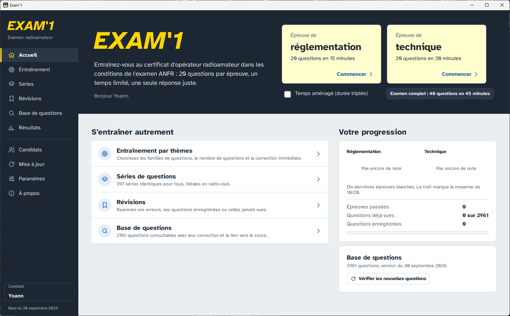

# Exam'1 (édition Qt 6 / QML)

Examens blancs du certificat d'opérateur du service amateur (radioamateur, ANFR), développés en C++17, Qt 6 et QML pour Windows et Linux.

L'application utilise la base de questions Exam'1, tenue à jour par Jean-Luc F6GPX. La base est mise à jour chaque trimestre, et l'application peut installer elle-même les nouvelles versions.

L'écran d'examen reproduit l'interface que l'ANFR utilise désormais pour l'examen (Evalbox). Toutes les questions sont présentées dans une seule liste verticale. Les propositions sont des cases à cocher, les questions peuvent être épinglées, une grille numérotée montre les questions répondues et épinglées, et le candidat valide l'ensemble une seule fois avec **Finaliser l'examen**.



## Fonctionnalités

- **Examens blancs dans les conditions de l'ANFR**
  - Épreuve de réglementation : 20 questions en 15 minutes. Épreuve de technique : 20 questions en 30 minutes. Chaque épreuve tire 2 questions dans chacune de ses 10 familles.
  - Examen complet : 40 questions dans une seule liste, comme la démonstration de l'ANFR. Les questions 1 à 20 portent sur la réglementation et les questions 21 à 40 sur la technique ; chaque épreuve reçoit sa propre note.
  - Temps aménagé (×3) pour les candidats ayant un taux d'incapacité d'au moins 70 %.
  - Barème actuel : 1 point par bonne réponse, et 0 point pour une réponse fausse, une absence de réponse ou plusieurs cases cochées. Une épreuve est réussie à partir de 10/20. L'ancien barème d'avant 2021 (+3 / −1) reste disponible.
  - Sauvegarde automatique toutes les quelques secondes (« dernière sauvegarde »). Une session interrompue par un plantage ou une coupure de courant peut être reprise depuis l'accueil.
- **Entraînement par thèmes** : choix libre des familles, du nombre de questions et de la durée, avec correction immédiate en option (commentaire et lien vers le cours de F6KGL).
- **Séries** : les séries fixes C, P, R et T publiées avec la base. Tout le monde reçoit les mêmes questions, ce qui convient aux séances en radio-club.
- **Révisions** : questions ratées lors de la dernière réponse, questions enregistrées et questions jamais vues.
- **Consultation de la base** : recherche par mot, valeur ou numéro, filtre par thème, par questions enregistrées ou par erreurs.
- **Résultats** : historique par candidat, évolution des notes, correction complète de chaque épreuve passée.
- **Plusieurs candidats** sur le même ordinateur, chacun avec ses propres résultats et statistiques.
- **Accessibilité** : police à lisibilité renforcée (Atkinson Hyperlegible) en dehors de l'écran d'examen, taille du texte réglable, thème sombre et réponses au clavier (A à D, P, Espace).
- **Mode portable** : un fichier vide `portable.txt` placé à côté de `exam1.exe` garde toutes les données dans un dossier `userdata` voisin, pratique sur une clé USB.

## Base de questions et mises à jour

La base est celle de la version web d'Exam'1 (exam1.r-e-f.org) et de l'application Android. Le REF la publie sous forme de trois fichiers :

| Fichier | Contenu |
|---|---|
| `questions.json` | questions, propositions, réponse, thème, commentaire, lien vers le cours, date de `version` |
| `series.json` | séries fixes (C, P, R, T) |
| `questions.zip` | une image par question (`<numéro>.png`) |

L'adresse par défaut est `https://exam1.r-e-f.org/assets/` ; elle peut être modifiée dans l'application.

- **Mise à jour en ligne** : l'application compare la `version` publiée à celle qui est installée, au démarrage (en option) ou à la demande. Elle télécharge ensuite les trois fichiers (environ 35 Mo) et construit une nouvelle base dans un dossier séparé. Elle ne bascule sur la nouvelle base qu'une fois la construction réussie : les données de l'utilisateur (candidats, notes, questions enregistrées) ne sont jamais touchées.
- **Import hors ligne** : choisir un dossier, ou une archive ZIP, contenant les trois fichiers.
- **Base fournie avec l'installeur** : si `packaging/data/` contient les trois fichiers au moment de la création du paquet, ils sont livrés avec l'installeur et installés au premier lancement. Les scripts `packaging/fetch_bank.sh` (Linux) et `packaging/fetch_bank.ps1` (Windows) téléchargent la base actuelle.

Dans `questions.json`, `reponse` numérote les propositions à partir de 0. L'import accepte aussi les fichiers numérotés à partir de 1 : il le déduit des valeurs présentes (présence d'un 0, ou absence de la dernière position).

### Affichage des questions à l'écran d'examen

À l'examen de l'ANFR, seules les questions comportant un schéma, une formule ou un dessin affichent une image ; les autres sont présentées en texte. Dans la base Exam'1, chaque question possède une image : l'énoncé dessiné sur une fiche jaune. Pour les questions illustrées, le champ `question` ne contient qu'une courte description.

À l'installation de la base, `src/statement.cpp` décide pour chaque question si elle s'affiche en texte seul. Les deux conditions suivantes doivent être réunies :

- **L'image ne contient que du texte.** Aucun trait sombre rectiligne de plus de 50 px environ (fils, axes, barres de fraction, cadres) et aucune zone colorée significative.
- **Le texte est un énoncé complet.** Il tient sur une seule ligne et se termine comme une question. Il ne renvoie pas à une figure (« schéma », « ce montage », « courbe »…) et n'emploie pas les abréviations d'unités en minuscules (« 14v », « 100 hz ») typiques des descriptions d'images.

Au moindre doute, l'image est conservée. Sur la base de septembre 2026, 1 695 questions sur 2 961 s'affichent en texte. Un réglage permet d'afficher l'image pour toutes les questions.

Chaque base est enregistrée sous forme d'une base SQLite (`bank.sqlite`) et d'un dossier `images/`, dans le dossier de données de l'application :

- Windows : `%APPDATA%\Exam1\Exam1`
- Linux : `~/.local/share/Exam1/Exam1`

## Compilation

### Linux (Ubuntu 24.04, Qt 6.4 de la distribution)

```bash
packaging/linux/build_linux.sh --install-deps   # la première fois : installe les dépendances de compilation
packaging/linux/build_linux.sh                  # compile build/exam1
packaging/linux/make_deb.sh --fetch-bank        # crée build/exam1_<version>_amd64.deb avec la base actuelle
sudo apt install ./build/exam1_4.0.1_amd64.deb
```

Sans `--fetch-bank`, le paquet ne contient pas la base, et l'application la télécharge au premier lancement.

### Windows (Visual Studio 2022, Qt 6.4 ou plus récent, Inno Setup 6)

Depuis l'**x64 Native Tools Command Prompt for VS 2022** :

```bat
packaging\windows\build_windows.bat C:\Qt\6.8.0\msvc2022_64 --fetch-bank
```

Le script :

1. compile avec CMake (Ninja, ou NMake si Ninja est absent) ;
2. déploie Qt avec `windeployqt` et copie le runtime Visual C++ à côté de l'exécutable ;
3. ajoute la base depuis `packaging\data` ;
4. compile `packaging\windows\exam1.iss` avec Inno Setup.

Il produit :

- `dist\Exam1\`, un dossier prêt à l'emploi ;
- `build-win\Exam1-<version>-setup.exe`, l'installeur.

Si aucun chemin de Qt n'est indiqué, le script utilise `%QTDIR%` ou le plus récent `C:\Qt\6.*\msvc20*_64`.

## Notes de développement

Ces variables d'environnement facilitent les tests :

- `EXAM1_USER_DIR` : remplace le dossier de données.
- `EXAM1_DATA_DIR` : remplace le dossier de la base fournie.
- `EXAM1_CAPTURE_DIR` : parcourt les écrans définis dans `Main.qml` (`tourStep`) et enregistre une capture de chacun. Fonctionne avec `QT_QPA_PLATFORM=offscreen`.

Le QML est compilé uniquement en bytecode (`--only-bytecode`), car le compilateur QML vers C++ de Qt 6.4 compile mal certaines résolutions de propriétés.

## Organisation du projet

```
src/                partie C++
  bankimporter.*    construit une base (SQLite + images) à partir de questions.json / series.json / questions.zip
  bankstore.*       base installée, gardée en mémoire
  statement.*       choix texte seul / image pour l'écran d'examen
  updater.*         vérification et téléchargement en ligne, import hors ligne, base fournie
  examsession.*     moteur d'examen : tirage, cases à cocher, épingles, chronomètre, notation, sauvegarde
  userstore.*       candidats, résultats, questions enregistrées, statistiques (user.sqlite)
  browsermodel.*    liste consultable de toute la base
  themes.*          les 20 familles de questions
qml/                interface utilisateur
  pages/ExamPage.qml        écran d'examen sur le modèle de l'interface ANFR / Evalbox
  components/EvalQuestion.qml, EvalCheck.qml
packaging/          scripts fetch_bank, compilation et paquets Linux et Windows
third_party/miniz   lecture des archives ZIP (MIT)
resources/          polices (OFL) et icônes
capture-accueil.png capture d'écran affichée dans ce README
```

## Remerciements

- Base de questions : Jean-Luc F6GPX, à partir des comptes rendus que les candidats envoient à la liste de diffusion *examen-radioamateur*.
- Exam'1 d'origine pour Windows : René Bussy F5AXG et Arnaud Dussart, avec André F8DEM.
- Version web d'Exam'1 et hébergement de la base : Valentin F4HVV, sur les serveurs du REF. Version Android : Maxime F4IQN.
- Cours vers lequel renvoient les corrections : radio-club de la Haute Île F6KGL / F5KFF.

Cette édition est une nouvelle réalisation. Elle ne contient aucun code du programme WinDev d'origine, et elle utilise la base de questions avec l'accord de ses auteurs.

## Licences

- Code de l'application : GNU GPL v3 ou ultérieure (voir `LICENSE`).
- Atkinson Hyperlegible : SIL Open Font License.
- miniz : MIT.
- Qt : LGPL v3.
- Les questions et les images appartiennent à leurs auteurs.
